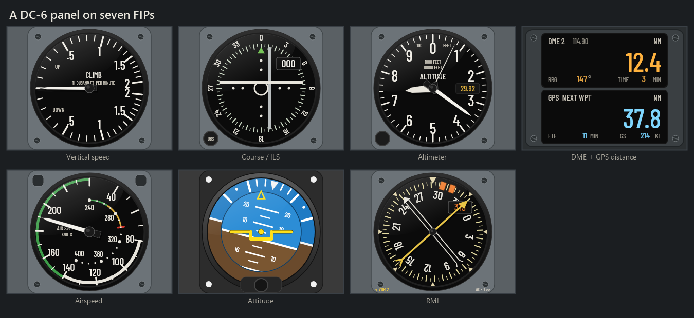
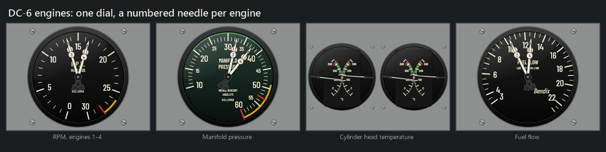
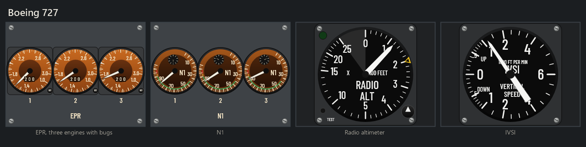
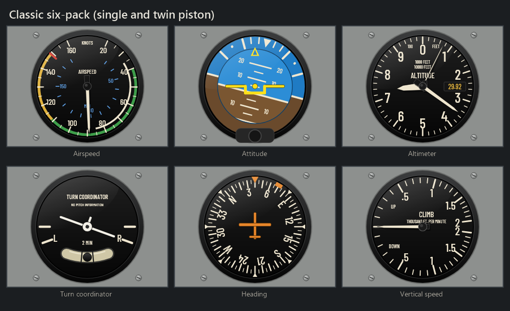
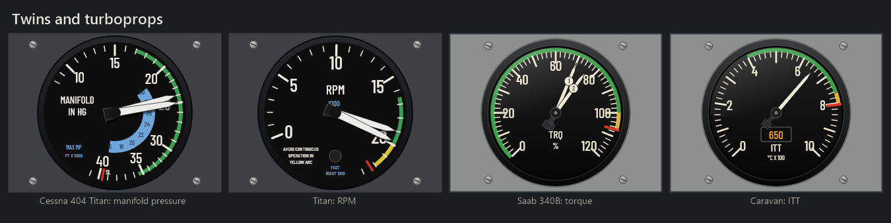

# FIPinator Live

**Free, realistic gauges on your Logitech (Saitek) Flight Instrument Panels, live from Microsoft Flight Simulator 2024.**

FREE and open source (AGPL-3.0): free to use, change, share and fork. No account, no subscription, no middleman.

FIPinator Live turns your FIPs into the round, analog instruments of the plane you're flying: airspeed, attitude,
altimeter, engine dials with a needle per engine, radio altimeters, RMIs and more. The needles follow the sim
smoothly, the FIP knobs work like the real knobs (set the altimeter, the heading bug, the course), and it talks
straight to the Logitech FIP driver and to MSFS 2024: no SPAD.neXt, FSUIPC, Axis and Ohs or MobiFlight needed.

**[Download FIPinator Live](https://github.com/Pribilof-Hangar/fipinator-live/releases)** (Windows 11, MSFS
2024). The installer can also add **FIPinator 3000**, Live's accessory for changing panels and gauges (a tick box,
on by default).

| | |
|---|---|
| **[FIPinator Live](https://github.com/Pribilof-Hangar/fipinator-live)** (you are here) | The main app: runs your FIPs from the sim. |
| **[FIPinator 3000](https://github.com/Pribilof-Hangar/fipinator-3000)** | Live's accessory: set up your panel like your desk, layouts, colours, combine gauges. |
| **[FIPinator gauges for SPAD.neXt](https://github.com/Pribilof-Hangar/fipinator-spad-gauges)** | A full-on SPAD.neXt person? The same gauges as SPAD.neXt gauges (a port, less tested). |

---

## What you get

- **Ready-made gauge sets**, drawn from the real instruments:
  - **PMDG DC-6**: flight and nav instruments, every engine gauge (one dial, a numbered needle per engine) and
    the overhead gauges.
  - **Boeing 727**: EPR with bugs and counters, N1, N2, EGT, fuel flow, radio altimeter, IVSI, ADI, HSI.
  - **Classic piston singles and twins**: the six-pack, engine gauges, nav, plus a Cessna 404 Titan set.
  - **Turboprops**: Cessna Caravan and Saab 340B engine gauges.
  - **Templates**: gear, flaps, trim, lights, autopilot and radios.
- **Working knobs and buttons**: where the real instrument has a knob, the FIP knob does the same job.
- **Few FIPs? No problem**: one FIP can hold up to 16 gauges. Flip with the page buttons or the left knob, or
  let them flip by themselves every few seconds.
- **Layouts**: a whole second set of gauges for the same FIPs (say *Nav* and *Engines*), switched on every FIP
  at once with one FIP button.
- **Easy to check**: status lights for the FIPs, the sim and the Logitech driver; "Test FIPs" shows which FIP is
  which; "What's on my FIPs" draws a cheat sheet of every gauge.
- **Problems made easy to report**: copy a problem report, or open a pre-filled GitHub issue (you review it and
  submit it yourself; personal details and FIP serial numbers are hidden).

*All pictures are drawn by FIPinator from its own gauge files, exactly as they appear on a FIP.*

---

## Getting started

1. **Install the Logitech FIP driver** from Logitech's support page, if you haven't already.
2. **Run the FIPinator Live installer.** No admin rights, no .NET to install, nothing else to download.
3. **Start FIPinator Live** (before or after the sim). The first time, **Check my setup** shows whether the
   driver, your FIPs and the sim are ready, and what to do next.
4. **Pick a panel** from the list (for example the DC-6 or a classic single). That's it: leave Live open
   while you fly, close it to stop.

Want different gauges on your FIPs? **Set up FIPs** in Live picks a gauge per FIP. For more (pages, flipping,
layouts, arranging your FIPs like your desk, changing colours), use **FIPinator 3000**.

## What it needs

- Windows 11 and Microsoft Flight Simulator 2024.
- The Logitech Flight Instrument Panel driver (Check my setup tells you if it's missing or old).
- Nothing else: Live carries its own .NET and the sim connection file.

**Only tested on Windows 11 with MSFS 2024.** It may well work elsewhere (another Windows version, MSFS 2020,
other sims that use SimConnect), but that hasn't been tested. If you want to try, an AI assistant is your friend:
give it this project and the [gauge-making guide](docs/guides/gauge-making-guide.md), and it can probably help you
adapt it. Share what you get working.

## How the pieces fit

- **FIPinator Live** (this repo) is the main app and works on its own. It only runs your FIPs.
- **[FIPinator 3000](https://github.com/Pribilof-Hangar/fipinator-3000)** is Live's accessory for making changes:
  arrange your FIPs like your desk, add pages and layouts, change colours, combine gauges. It needs Live, and it
  doesn't need to be open while you fly.
- **[FIPinator gauges for SPAD.neXt](https://github.com/Pribilof-Hangar/fipinator-spad-gauges)**: if you're a
  full-on SPAD.neXt person, this is all you need (no Live). It's a port of the same gauges and less tested than
  Live. Using SPAD.neXt for your other gear and Live for the FIPs? See
  [Using SPAD.neXt and FIPinator Live together](docs/guides/spad-and-live.md).

## Known issues

- **A FIP may freeze for about 5 seconds now and then.** With many FIPs, Logitech's FIP driver sometimes gets
  stuck taking a picture; the sim and the other FIPs keep going. Live keeps it rare. Tips:
  [FIP and USB tips](docs/FIP-USB-TIPS.md).
- **A FIP can stay dark after restarting the PC.** Unplug it and plug it back in, or switch its hub port off and
  on; Live picks it up by itself. See the same tips page.

## Guides

- [Few FIPs? Flip gauges with the left knob](docs/guides/few-fips.md)
- [Using SPAD.neXt and FIPinator Live together](docs/guides/spad-and-live.md)
- [FIP and USB tips](docs/FIP-USB-TIPS.md)
- [Making a brand-new gauge with AI](docs/guides/making-gauges-with-ai.md) and the
  [gauge-making guide](docs/guides/gauge-making-guide.md) (Claude recommended, any AI works)

## The story

I made FIPinator for my own PMDG DC-6 in MSFS 2024, and that's mostly what I fly. The DC-6 gauges are the ones I
really know work. I've also flown some with the Boeing 727 and the Saab 340B and fixed what I found. The rest
(classic singles and twins, Cessna 404 Titan, Caravan, 737 MAX, radios, autopilot and more) I made for fun.
**Not every gauge has been tested**: most work, some may need work, and the basic layout of every gauge is already
there, so fixing one is usually a small job. If you know your way around gauges, or have an AI helper, you can
fix them.

FIPinator Live runs my FIPs every day. I use SPAD.neXt for my other gear (yoke, GPS, throttle quadrant) with its
FIP support switched off. That's not because SPAD.neXt is bad (it's great); I built Live myself and it works for
me.

I got what I wanted out of this project, so **I have no plans to keep it updated.** If I get bored, or if it
catches on, I might come back with my AI to look at issues and make a few more gauges, but **no promises**. It's
for the world now: use it, mod it, personalise it, fork it, make it better. I like to think there are some great
people out there who can take this to a new level.

## Testers wanted

Try it with your planes. If something's off, **open an issue** and say which gauge, which plane and what happens
(Live's **Report a problem** button fills most of it in for you). Someone else may have the same problem, someone
may already know the fix, and I might get to it myself now and then. Found a fix? Post it in the issue, or fix it
in your fork and share it.

## Made with AI

All of this was built with an AI assistant (Claude). The hard part is done and documented: how the gauges are
drawn, which sim values and knob commands work, what needed working around. **Point your own AI at this repo**
and ask it to fix a gauge or make a new one: the [AI README](docs/guides/making-gauges-with-ai.md) and the
[gauge-making guide](docs/guides/gauge-making-guide.md) are written for it (Claude recommended, any AI works).

## Built from scratch

FIPinator was written from scratch: its own code talks straight to Logitech's FIP driver and to MSFS through
SimConnect, instead of building on an existing tool. That keeps it small, free and easy to change, but it's
young: expect quirks that long-established tools have already ironed out. If you find one, report it, or fix it
and share the fix. Anyone is free to fork it and do whatever they like with it.

Made and tested on Windows 11 with MSFS 2024. Not made by, affiliated with or endorsed by Logitech, Microsoft or
PMDG.
