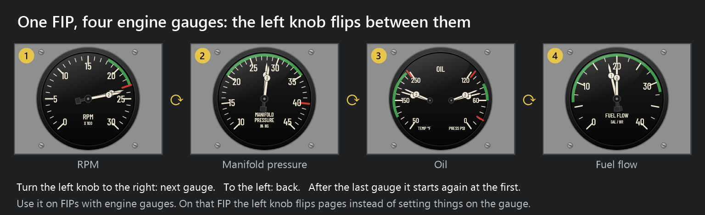

# Few FIPs? Flip gauges with the left knob

A real cockpit has a dozen or more instruments. Most of us have one to four FIPs. FIPinator Live
lets one FIP hold up to **16 gauges** and flip between them, so you can fly a full panel on a few screens.

## Two ways to flip

| | Page buttons | Left knob |
|---|---|---|
| How | Press the FIP's page up / page down buttons | Turn the FIP's left knob: right = next gauge, left = back; after the last it starts again at the first |
| Gauge knobs | Both knobs work on the gauge (altimeter pressure, heading bug...) | Only the **right** knob works on the gauge |
| Best for | Gauges you set with knobs | Engine gauges (you just read them) |

Either way, the gauge's name shows on the FIP for 2 seconds when you flip, and Live remembers which gauge
each FIP was showing for next time.

## Or let them flip by themselves

In FIPinator 3000's **Set up your panel**, right-click a FIP and pick **Flip pages by itself**: the next
gauge every 3, 5, 10, 20 or 30 seconds, like a car dashboard cycling through its readouts. It's **off** by default.

- 5 seconds is a good start: enough time to read a needle. (Shorter than 3 seconds isn't offered: the
  screen would change before you've read it.)
- With **Flip pages with the left knob** also ticked, turning the knob picks a gauge and **holds it for 30
  seconds**, then flipping carries on by itself.
- When a gauge flips by itself, its name shows for just 1 second, so it doesn't cover the needles.
- On a FIP that flips by itself, the page up/down buttons don't flip the gauges (use the left knob).
- A screen that changes every few seconds can catch your eye on a long flight; use it on engine FIPs,
  not on the ones you fly by.

## Set it up (about a minute)

Pages are set up in **FIPinator 3000**, FIPinator Live's companion (Live's own Set up FIPs keeps it simple:
one gauge per FIP). The sim doesn't need to be running, and 3000 doesn't need to stay open while you fly.

1. Open **FIPinator 3000** and click **Set up your panel** (or in Live: **What's on my FIPs** →
   **Change this panel in FIPinator 3000**).
2. Right-click a FIP's box → **Add a gauge to flip through...** for each extra gauge (*Manifold pressure*,
   *Oil*, *Fuel flow*...).
3. Right-click it again → tick **Flip pages with the left knob**, if you want the knob to flip them.
4. Click **Save**. FIPinator Live shows the change when you switch panels or restart it.

Not sure which FIP is which? In Live, **Test FIPs** puts each FIP's short name on its screen.
Want to check what's where? **What's on my FIPs** shows a picture of every page.

With more FIPs you can also make whole **layouts** in 3000 (say *Nav* and *Engines*) and switch every FIP
between them with one FIP button.

## Ideas for your panel

These are starting points; swap gauges around until it feels right.

**1 FIP**: use the **page buttons** (keep both knobs for the gauges): attitude, altimeter, airspeed,
heading, then your engine gauges.

**2 FIPs**
- FIP 1, page buttons: attitude, altimeter, airspeed, heading.
- FIP 2, left knob: RPM, manifold pressure, oil, fuel flow, fuel.

**3 FIPs**
- FIP 1: attitude (one gauge, always there).
- FIP 2, page buttons: altimeter, airspeed, heading, vertical speed.
- FIP 3, left knob: all the engine gauges.

**4 FIPs**
- FIP 1: attitude. FIP 2: altimeter. FIP 3, page buttons: airspeed, heading, course/ILS, RMI.
- FIP 4, left knob: all the engine gauges.

More gauges in fewer pages: some built-in gauges already show several things at once, such as the
engine summary pages (RPM, manifold pressure and more for every engine on one screen), the four-needle
RMI (VOR 1, VOR 2, ADF 1, ADF 2), and the engine dials with one needle per engine. FIPinator 3000 can
also combine two gauges side by side on one FIP (**Combine**).

## If something doesn't work

Changes below are made in FIPinator 3000 (right-click the FIP's box in **Set up your panel**), then **Save**.

- **The left knob does nothing.** Check that the FIP has more than one page and **Flip pages with the left
  knob** is ticked.
- **I can't set the altimeter any more.** Its FIP flips pages with the left knob. Untick it for that FIP (and
  use the page buttons), or move the altimeter to another FIP.
- **The page buttons don't flip.** On a FIP that flips with the left knob or flips by itself, the left knob
  (or the timer) does the flipping instead.
- **It keeps flipping away from the gauge I want.** Tick **Flip pages with the left knob** too: a knob turn
  holds the gauge for 30 seconds. Or set **Flip pages by itself** back to **Off**.

## Using SPAD.neXt too?

This guide is about FIPinator Live. In SPAD.neXt, the FIP's page up / page down buttons flip between
the gauges loaded on that FIP. SPAD.neXt sets this up itself. Flipping with the left knob and flipping
by itself work in FIPinator Live only.

## What's been tested

- Flipping with the left knob: tested on real FIPs (Windows 11, MSFS 2024) on 2026-11-09.
- Flipping by itself: the flip timer and the 30-second hold have automatic tests. Since 2026-11-14 the
  settings are made in FIPinator 3000; not yet tried there with FIPs plugged in.
